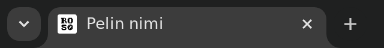

# RG Game Jam Template

Roso Games Game Jamin pohja. Ryhmä tekee pelinsä omaan GitHub-repositorioon, joka luodaan tästä pohjasta. Peli julkaistaan ryhmän GitHub Pages -sivulla, jossa sitä voi pelata suoraan selaimessa ilman latauksia tai asennuksia.

Repositoriossa on kaksi kansiota, joita tarvitset:

- `src`-kansiossa on pelin Solar2D-projekti. Tähän kansioon tehdään koko peli.
- `web`-kansiossa on pelin sivu. Pelin HTML5-build kopioidaan sen `app`-kansioon.

Tee osat järjestyksessä. Osat 1–3 tekee vain yksi ryhmäläinen. Ne tehdään vain kerran.

## 1. Repositorion luominen

1. Kirjaudu GitHubiin ja avaa pohjan sivu <https://github.com/RosoTuotanto/RG-Game-Jam-Template>.
2. Paina tiedostolistan yläpuolella olevaa **Use this template** -nappia ja valitse **Create a new repository**.
3. Valitse **Owner**-kohtaan oma käyttäjänimesi.
4. Kirjoita **Repository name** -kohtaan repositoriolle lyhyt nimi ilman välilyöntejä ja ääkkösiä, esimerkiksi `pimeys-peli`. Nimestä tulee osa pelin sivun osoitetta.
5. Valitse näkyvyydeksi **Public**. Ilmaisella GitHub-tilillä GitHub Pages ei julkaise mitään yksityisestä repositoriosta.
6. Paina **Create repository from template**.

GitHub avaa uuden repositoriosi. Sen **Actions**-välilehdellä voi jo näkyä punaisella merkitty epäonnistunut ajo. Se johtuu siitä, ettei GitHub Pages ole vielä käytössä. Osa 2 korjaa asian.

## 2. GitHub Pagesin käyttöönotto

1. Paina repositoriosi sivulla **Settings** ja valitse vasemmasta reunasta **Pages**.
2. Valitse **Build and deployment** -kohdan **Source**-valikosta **GitHub Actions**.
3. Avaa repositoriosi **Actions**-välilehti ja valitse vasemmasta listasta **Deploy to GitHub Pages**.
4. Paina **Run workflow** ja sen jälkeen avautuvan ikkunan **Run workflow** -nappia.
5. Odota, että ajo valmistuu ja sen kohdalle tulee vihreä merkki. Jos merkki on punainen, tarkista vaihe 2 ja tee vaiheet 3–4 uudestaan.
6. Avaa **Settings** > **Pages** ja paina **Visit site**.

Pelin sivun osoite on muotoa `https://käyttäjänimi.github.io/repositorion-nimi/`, esimerkiksi `https://esimerkki.github.io/pimeys-peli/`. Sivulla pitäisi näkyä otsikko "Pelin nimi" ja sen alla peli, jossa lukee "Ryhmän nimi" ja "Peli toimii selaimessa!". Jaa osoite ryhmällesi.

## 3. Ryhmän kutsuminen

Kutsu muut ryhmäläiset repositorioon kollaboraattoreiksi kohdasta **Settings** > **Collaborators** > **Add people**. Ohjeet löydät oppitunnilta [Repositorion jakaminen](https://www.rosogames.fi/lms/3-pelisuunnittelu-ja-prototyypittaminen/lessons/repositorion-jakaminen/).

## 4. Julkaisun testaaminen omalla buildilla

Tässä osassa varmistatte, että osaatte julkaista pelistänne uuden version. Tämän voi tehdä kuka tahansa ryhmäläinen.

1. Kloonaa repositorio koneellesi esim. GitHub Desktopilla. Ohjeet löydät oppitunnilta [Repositorion päivittäminen](https://www.rosogames.fi/lms/3-pelisuunnittelu-ja-prototyypittaminen/lessons/repositorion-paivittaminen/). Tässä ohjeessa "repositorion kansio" tarkoittaa kansiota, johon kloonasit repositorion. Saat sen auki GitHub Desktopista valitsemalla **Repository** > **Show in Explorer** (macOSissa **Show in Finder**).
2. Valitse Solar2D Simulatorissa **File** > **Open Project...** ja avaa repositorion kansiosta `src/main.lua`. Simulatorissa lukee "Ryhmän nimi" ja "Peli toimii Solar2D Simulatorissa!".
3. Avaa `src/main.lua` koodieditorissa. Vaihda rivillä `local teamName = "Ryhmän nimi"` lainausmerkkien sisällä oleva teksti ryhmänne nimeksi ja tallenna tiedosto.
4. Valitse Simulatorissa **File** > **Relaunch** ja tarkista, että ryhmänne nimi näkyy.
5. Valitse Simulatorissa **File** > **Build** > **HTML5**.
6. Kirjoita **Application Name** -kohtaan pelin nimi ilman välilyöntejä ja ääkkösiä, esimerkiksi `PimeysPeli`.
7. Valitse **Save to Folder** -kohtaan kansio, joka on repositorion kansion ulkopuolella, esimerkiksi työpöytä. Repositorion kansioon tallennettu build päätyisi GitHubiin. Jos build on `src`-kansiossa, Solar2D pakkaa sen myös seuraavan buildin sisään.
8. Paina **OK** (macOSissa **Build**). Solar2D luo valitsemaasi kansioon `PimeysPeli.html5`-kansion, jossa on pelin HTML5-build.
9. Avaa repositorion kansiosta `web/app`-kansio ja poista kaikki sen sisältämät tiedostot.
10. Avaa `PimeysPeli.html5`-kansio ja kopioi kaikki sen sisältämät tiedostot `web/app`-kansioon. Älä kopioi itse `PimeysPeli.html5`-kansiota. Kopioinnin jälkeen `index.html`-tiedoston pitää olla suoraan `web/app`-kansiossa.
11. Tee GitHub Desktopissa commit ja paina **Push origin**.
12. Avaa repositorion **Actions**-välilehti ja odota, että uusin ajo saa vihreän merkin.
13. Lataa pelin sivu uudelleen selaimessa. Pelissä pitäisi nyt lukea ryhmänne nimi ja "Peli toimii selaimessa!".

## 5. Oman pelin aloittaminen

Poistakaa `src/main.lua`-tiedostosta kaikki rivit `display.setStatusBar( display.HiddenStatusBar )` -rivin jälkeen ja aloittakaa pelinne tekeminen.

## Pelin päivittäminen sivulle

Kun haluatte julkaista pelistä uuden version, hakekaa ensin muiden muutokset GitHub Desktopissa: painakaa **Fetch origin** ja sen jälkeen **Pull origin**, jos se tulee näkyviin. Näin build tehdään pelin uusimmasta versiosta. Tehkää sitten osan 4 vaiheet 5–13 uudestaan. Sopikaa ryhmässä, kuka buildaa ja julkaisee pelin, ettei kaksi ryhmäläistä puske eri buildeja samaan aikaan.

Testatkaa selainversiota jo jamin aikana eikä vasta lopussa, jotta mahdolliset ongelmat huomataan ajoissa.

## Sivun muokkaaminen

Avaa `web/index.html` koodieditorissa ja vaihda siitä nämä tekstit omiisi:

- `<title>`-rivin teksti, joka näkyy selaimen välilehdessä,
- `<meta name="description">`-rivin teksti "Lyhyt kuvaus pelistä.",
- otsikko "Pelin nimi" ja sen alla oleva lyhyt kuvaus,
- "Tekijät"-rivi, johon tulee jokaisen ryhmäläisen haluama nimi.

Sivun värit ja pelin koko ovat tiedoston alussa `:root`-kohdassa. Pohjan peli on vaakasuuntainen. Jos teette pystysuuntaisen pelin, vaihtakaa `--game-width`- ja `--game-height`-arvot keskenään.

### Favicon

Favicon on pieni kuva, joka näkyy selaimen välilehdessä sivun nimen vieressä. Pohjassa on valmiina Roso Gamesin favicon:

Faviconin voi jättää ennalleen. Jos haluatte oman faviconin, korvatkaa `web`-kansion tiedostot `favicon.ico`, `favicon.svg`, `favicon-96x96.png`, `apple-touch-icon.png`, `web-app-manifest-192x192.png` ja `web-app-manifest-512x512.png` samannimisillä ja samankokoisilla kuvilla.

## Ongelmatilanteet

- **Sivulla lukee "Peliä ei voitu ladata"**: `web/app`-kansiossa ei ole `index.html`-tiedostoa. Tarkista, että kopioit buildin tiedostot etkä koko `.html5`-kansiota. Tarkista myös, että puskit muutokset GitHubiin.
- **Sivu ei päivity**: tarkista, onko **Actions**-välilehden uusin ajo punainen. Avaa ajo ja kysy apua **#help-desk**istä, jos et saa virhettä selville.
- **Sivun osoite antaa 404-virheen**: GitHub Pages ei ole käytössä tai repositorio on yksityinen. Tarkista osa 2 ja repositorion näkyvyys.

## Lisenssi

[Unlicense](LICENSE)

Pohja on julkaistu public domainiin, joten kuka tahansa saa kopioida, muokata ja käyttää sitä mihin tahansa tarkoitukseen. Ryhmä voi vaihtaa repositorionsa lisenssin haluamakseen.
